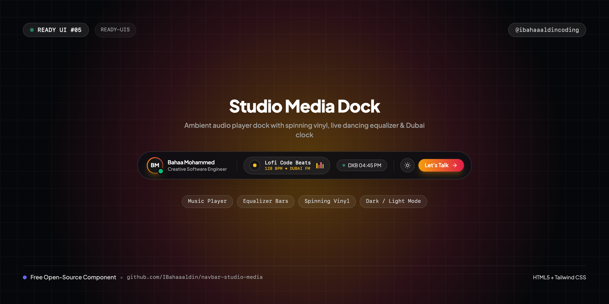
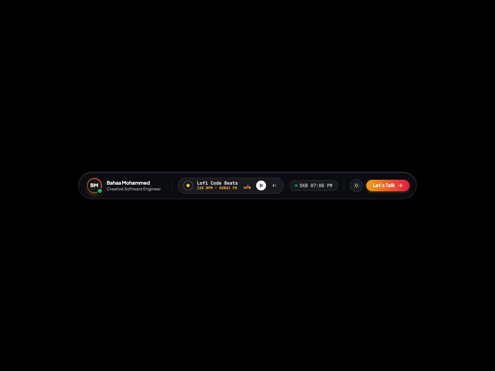
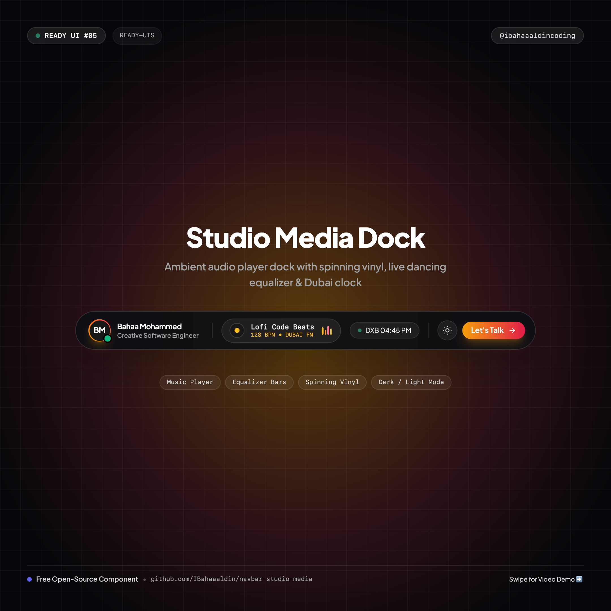
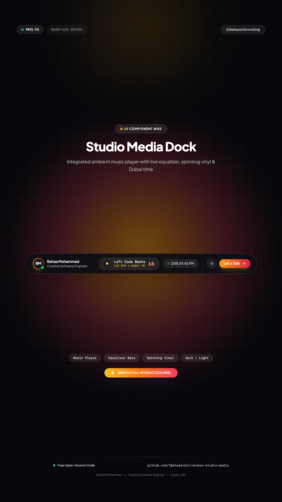

# 🎧 Studio Media Dock Navbar

> An ultra-aesthetic floating creative studio dock with an integrated ambient music player, dancing audio equalizer, spinning vinyl disk, real-time Dubai clock, and dark/light mode.



[](https://IBahaaaldin.github.io/navbar-studio-media/)
[](https://IBahaaaldin.github.io/navbar-studio-media/)

---

## 🌐 Visual Previews

| Desktop Showcase (1200x900) | Mobile Showcase (390x844) | Post Cover (1080x1080) | Reel Cover (1080x1920) |
| :---: | :---: | :---: | :---: |
|  |  |  |  |

*(Includes full interaction videos: `video-desktop.mp4` and `video-mobile.mp4`)*

---

## ✨ Features & Micro-Interactions

- **Clean Minimal Canvas**: Floats dead-center both horizontally and vertically on a pure black (`#000000`) or white (`#ffffff`) canvas with zero clutter.
- **Integrated Ambient Audio Player**:
  - Rotating vinyl record disc that spins smoothly while audio is active.
  - Interactive play/pause toggle that freezes/resumes the vinyl and equalizer bars.
  - Next track button cycling through lo-fi coding tracks (*Lofi Code Beats*, *Cyberpunk Skyline*, *Tokyo Rain*, *Deep Focus*).
- **Dancing Equalizer Waveform**: 4 animated audio equalizer bars reacting with rhythmic pulse timing.
- **Magnetic Sliding Tab Capsule**: Physics-based pill indicator that tracks your cursor smoothly across navigation links.
- **Live Dubai Clock**: Real-time ticking Dubai time pill (`DXB 04:45 PM`) with pulsing green status dot.
- **Strict Single-Line Text**: Names and descriptions strictly kept on single rows with `whitespace-nowrap`.
- **Instant Theme Switcher**: Sun ☀️ / Moon 🌙 button built directly into the dock to toggle dark/light theme.
- **Responsive Mobile Drawer**: Mobile navigation with embedded track controller, live clock, and CTA button.
- **Zero Build Step**: 100% self-contained HTML5 + Tailwind CSS CDN + inline SVGs.

---

## 📁 Repository Structure

```text
├── index.html              # Standalone production navbar component
├── cover.png               # Widescreen cover banner (1280x640)
├── cover-instagram.png     # Square post cover for Instagram (@ibahaaaldincoding) (1080x1080)
├── cover-reel.png          # 9:16 vertical cover for Instagram Reels (1080x1920)
├── screenshot-desktop.png  # Desktop visual preview (1200x900)
├── video-desktop.mp4       # Desktop interaction recording (MP4)
├── screenshot-mobile.png   # Mobile visual preview (390x844)
├── video-mobile.mp4        # Mobile interaction recording (MP4)
├── record.js               # Playwright automation script used to record all 4 assets
├── README.md               # Documentation & setup notes
└── CAPTION.md              # Ready-to-copy Instagram caption for @ibahaaaldincoding
```

---

## 🚀 Quick Start

### 1. View Locally
Simply open `index.html` in your browser:
```bash
open index.html
```

### 2. Interaction
Click the **Play/Pause** button or the **Next Track** button to interact with the live audio player and equalizer.

---

## 📬 Connect

- **Instagram**: [@ibahaaaldincoding](https://www.instagram.com/ibahaaaldincoding)
- **GitHub**: [@IBahaaaldin](https://github.com/IBahaaaldin)
- **LinkedIn**: [Bahaa Mohammed](https://www.linkedin.com/in/bahaa-mohammed-371259369)
- **Email**: bahaam.coding@gmail.com
